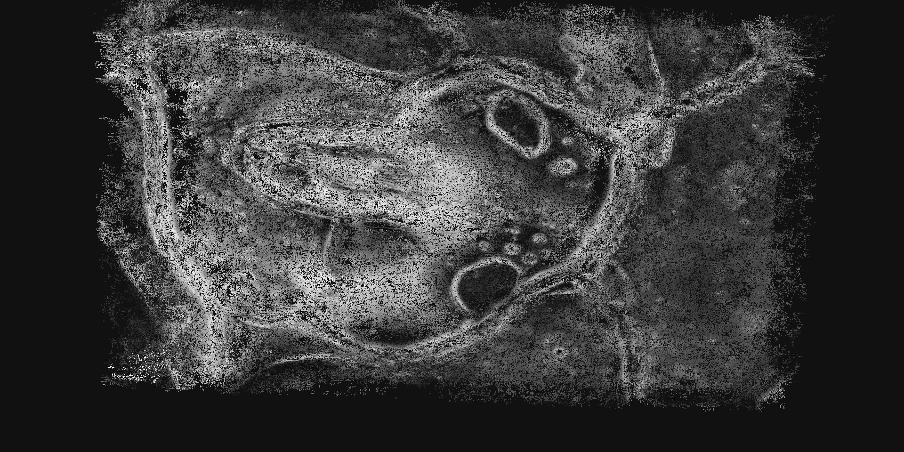

# 3D Pointcloud from Microscopic Focus-Slice Video

Using Python and Open3D to reconstruct a 3D pointcloud from a short microscopic focus-slice video.



## How It Works
* Extracts individual focus-slice frames from a microscope video (`record_mode1_2026-10-15_22-36-32.wmv`).
* Computes sharpness/focus depth across slices to estimate Z-axis elevation.
* Generates and visualizes an interactive 3D pointcloud using **Open3D**.

## Quick Start
1. **Install dependencies:**
   ```bash
   pip install open3d opencv-python numpy
   ```
2. **Run the script:**
   ```bash
   python PointCloud-ver100.py
   ```

## Files in This Repository
* `PointCloud-ver100.py` — Main Python script for processing the video and building the pointcloud.
* `record_mode1_2026-10-15_22-36-32.wmv` — Sample microscopic focus-slice input video.
* `output.gif` — Preview animation of the resulting 3D pointcloud.
